# UAP P2P Network – Communication and File Sharing

**Course:** CSE 433 – Blockchain & Distributed Security Lab
**University:** University of Asia Pacific, Department of CSE
**Student Name:** `<Shourov Chandra Bormon>`
**Student ID:** `<22201028>`  **Section:** `<AB>`

---

## 1. Project Description

This project is a lightweight **peer-to-peer (P2P) application** written in Python using **TCP sockets**.
Each running copy of the program is one **peer**. Every peer works in two roles at the same time:

- **Server role** – it listens on a port and accepts incoming connections from other peers.
- **Client role** – it can connect to any other peer using that peer's IP address and port.

Because of this, peers talk to each other **directly**. There is **no central server**.

Once two peers are connected, they can:

- exchange **text messages**;
- send **files** (text, images, audio, video, PDF, ZIP, or any other ordinary file), because every file is treated as plain binary data;
- stay connected to **multiple peers** at once and choose which peer to send to.

The application has a simple Tkinter graphical interface showing the connected-peer list and a live message/event log.

### Key features

| Feature | How it is done |
|---|---|
| Peer startup | User enters a name and listening port; a server socket starts listening |
| Peer connection | User enters remote IP and port; a TCP client connection is made |
| Peer identification | `hello` / `hello_ack` handshake exchanging `peer_id`, `peer_name`, `port` |
| Concurrency | One thread per connection, so many peers can be handled at the same time |
| Message framing | `[4-byte length][JSON payload]` so message boundaries are never lost |
| Text messaging | `text` message type, sent to the selected peer |
| File transfer | `file` metadata (`filename`, `filesize`) followed by the exact number of raw bytes, sent in 64 KB chunks |
| Received files | Saved in the `downloads/` folder (existing files are never overwritten) |
| Error handling | Invalid IP/port, connection refused, missing file, unexpected disconnects, etc. are shown in the log without crashing |

---

## 2. Requirements

- **Python 3.9 or later**
- **Tkinter** (for the GUI)
  - Windows / macOS: included with the standard Python installer from python.org
  - Ubuntu / Debian: `sudo apt install python3-tk`
- **Operating system:** Windows, Linux, or macOS
- **No third-party packages** are needed. Only the Python standard library is used:
  `socket`, `threading`, `json`, `struct`, `os`, `queue`, `tkinter`.
- **Network:** for testing on one computer, nothing extra is needed. For the final demo, all computers must be on the same LAN / Wi-Fi.

---

## 3. Project Structure

```
P2P_Network/
|
|-- main.py            # Tkinter GUI and user interaction
|-- p2p_node.py        # Networking: server/client sockets, threads, handshake, text and file transfer
|-- protocol.py        # Message framing and message builders (hello, hello_ack, text, file)
|-- requirements.txt   # (no third-party packages needed)
|-- README.md          # This file
|
`-- downloads/         # Files received from other peers are saved here
```

---

## 4. Installation / Setup

1. **Install Python 3.9+** from <https://www.python.org/downloads/>.
   On Windows, tick **"Add Python to PATH"** during installation.
2. **Check the installation** in a terminal / Command Prompt:
   ```
   python --version
   ```
   (On Linux/macOS you may need to use `python3` instead of `python`.)
3. **Extract** the submitted ZIP file. You will get the `P2P_Network` folder.
4. **No `pip install` is required.**
5. *(Linux only)* If you get `No module named tkinter`, install it:
   ```
   sudo apt install python3-tk
   ```

---

## 5. How to Run the Application

Open a terminal inside the `P2P_Network` folder and run:

```
python main.py
```

The **UAP P2P Network** window will open. To run several peers on one computer, open **a new terminal for each peer** and run the same command again.

Then, in each window:

1. Type a **Name** (for example `Alice`).
2. Type a **Port** (for example `5000`). Every peer must use a **different port** when running on the same computer.
3. Click **Start Peer**.

The window shows your peer information, for example `Alice | ID: a83f21c4 | Port: 5000`, and the log shows
`[SYSTEM] Peer started: Alice [a83f21c4] on port 5000`.


> 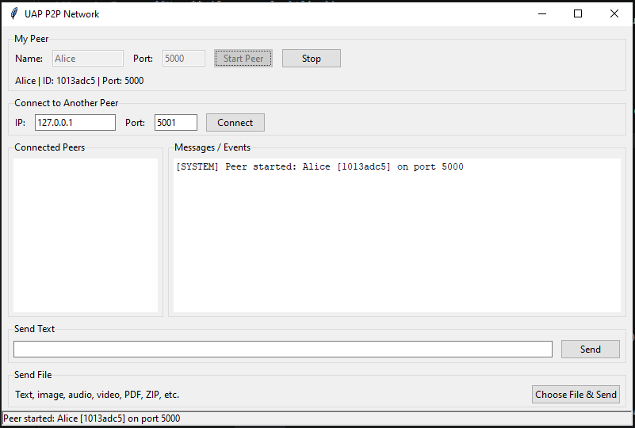

---

## 6. How to Connect Two Peers

### A. Two peers on the same computer

| Peer | Name | Port |
|---|---|---|
| A | Alice | 5000 |
| B | Bob | 5001 |

1. Start **Alice** on port `5000` and **Bob** on port `5001` (two terminals, two windows).
2. In **Bob's** window, under **Connect to Another Peer**, enter:
   - IP: `127.0.0.1`
   - Port: `5000`
3. Click **Connect**.
4. Both windows now show the other peer in the **Connected Peers** list, and the log shows `[SYSTEM] Connected to Alice` (and `Connected to Bob` on Alice's side).

> 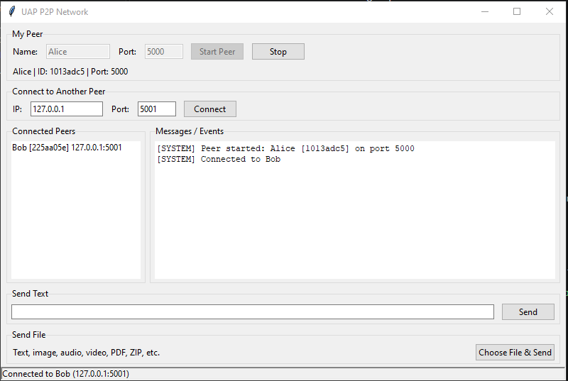
> 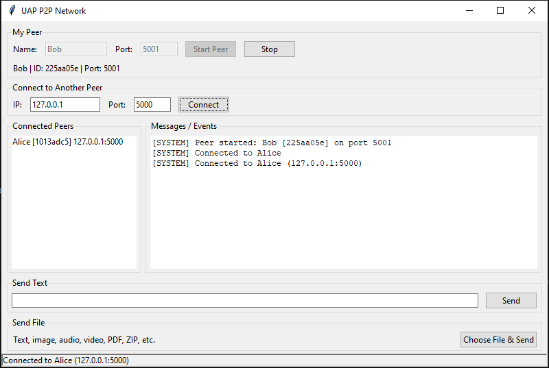

### B. Two different computers (same Wi-Fi / LAN)

1. Find the IP address of Computer A:
   - Windows: run `ipconfig` and read **IPv4 Address** (for example `192.168.1.10`)
   - Linux / macOS: run `ip a` or `ifconfig`
2. Start a peer on each computer (for example Computer A: port `5000`, Computer B: port `5001`).
3. On Computer B, enter Computer A's IP (`192.168.1.10`) and port (`5000`) and click **Connect**.
4. If the connection is refused or times out, allow Python through the firewall (Windows: *Windows Defender Firewall → Allow an app*), and make sure both computers are on the same network.

### C. Connecting more than two peers

Start a third peer (for example `Charlie`, port `5002`) and connect it to **both** Alice (`127.0.0.1:5000`) and Bob (`127.0.0.1:5001`) by entering each address and clicking **Connect** once per peer. Each peer can now talk to every other peer directly.

```
        Alice (5000)
         /        \
  Bob (5001) --- Charlie (5002)
```
> 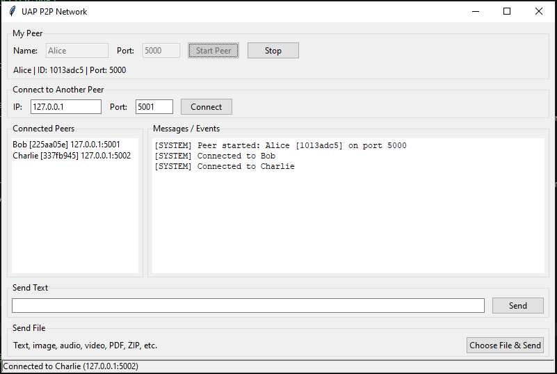
> 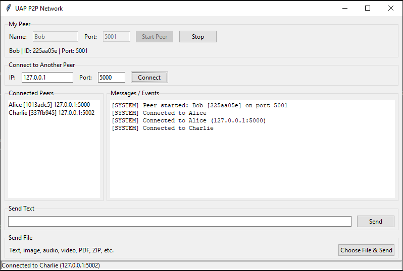
> 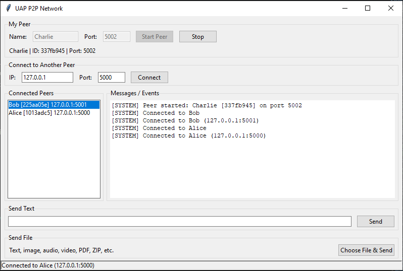

---

## 7. How to Send Text Messages

1. In the **Connected Peers** list, **click the peer** you want to send to (it becomes highlighted).
2. Type the message in the **Send Text** box.
3. Press **Send** (or the Enter key).

The sender's log shows `Alice -> Bob: Hello Bob!` and the receiver's log shows `Bob -> Alice: Hello Alice!`.

> 1. A text message sent from A to B (show both windows' logs).
> 2. A text message sent from B to A (show both windows' logs).
>
> 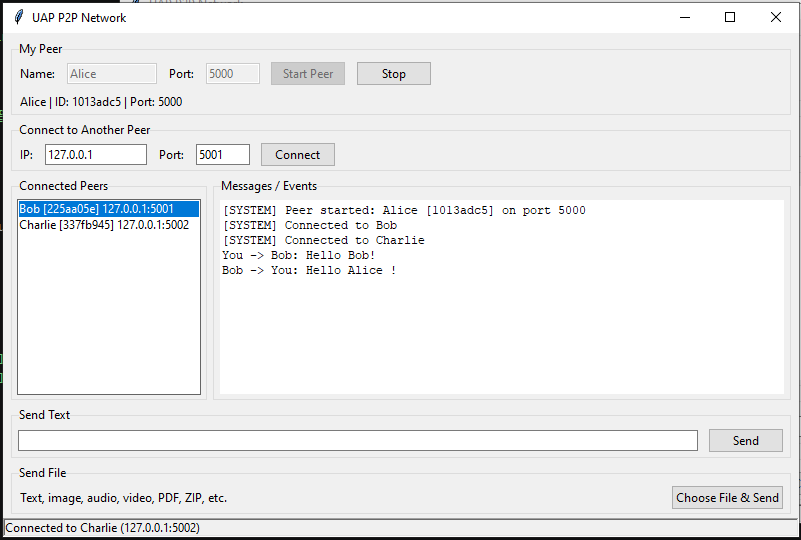
> 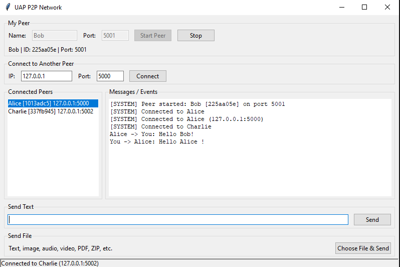

---

## 8. How to Transfer Files

1. In the **Connected Peers** list, **click the peer** that should receive the file.
2. Click **Choose File & Send**.
3. Select any file in the dialog (image, audio, video, PDF, ZIP, text, ...).
4. The sender's log shows `You -> Bob: File sent: photo.jpg`; the receiver's log shows `Alice -> You: File received: photo.jpg`, and the status bar shows the saved path (for example `Received: downloads\photo.jpg`).
5. The file is saved in the receiver's `downloads/` folder. If a file with the same name already exists, a number is added (`photo_1.jpg`) so nothing is overwritten.

### How the transfer works (short explanation)

1. The sender sends a framed JSON **metadata** message: `{"type": "file", "filename": "photo.jpg", "filesize": 2456789, ...}`.
2. The sender then sends the **raw bytes** of the file in **64 KB chunks** (the whole file is never loaded into memory at once).
3. The receiver reads **exactly `filesize` bytes** from the TCP stream and writes them to `downloads/`. The file size from the metadata, not a single `recv()` call, decides when the transfer is complete.

> 1. **Image** sent from A to B – sender log + receiver log.
> 2. **Audio** file sent from B to A – sender log + receiver log.
> 3. **Video** file sent from A to B – sender log + receiver log.
> 4. *(Optional)* A PDF or ZIP file transfer.
> 5. The receiver's **`downloads/` folder** open in File Explorer showing the received files (and that they open/play correctly).
>
> 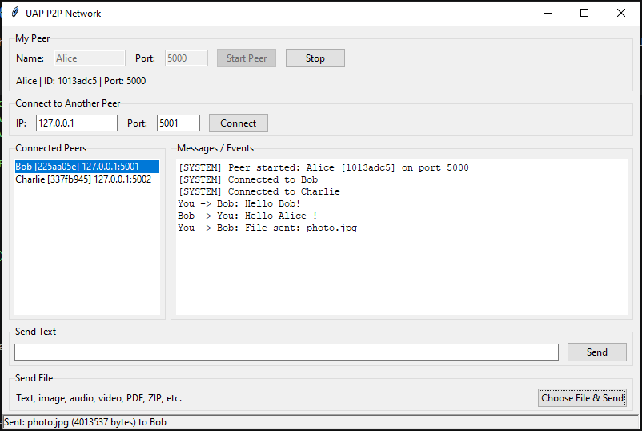
> 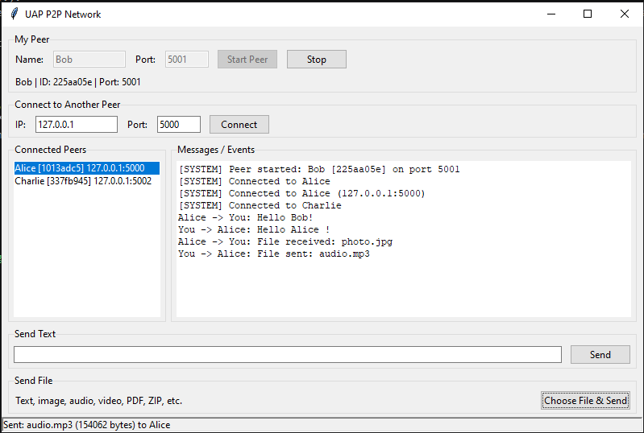
> 
> 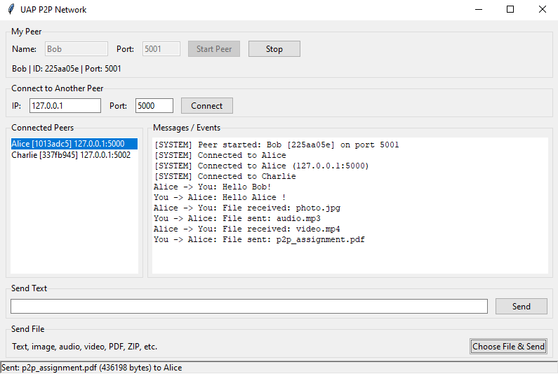
> 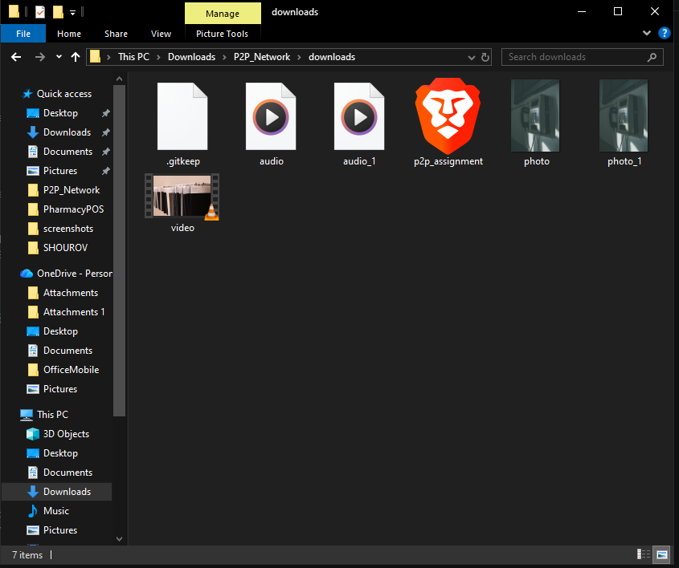

---

## 9. Communication Between Multiple Peers

With Alice, Bob, and Charlie all connected, select a different peer in the list each time to choose who receives the message or file:

- Alice ↔ Bob
- Bob ↔ Charlie
- Charlie ↔ Alice
- File transfer between different pairs (for example Bob → Charlie, Charlie → Alice)

> 1. Charlie sends a text message to Alice and to Bob (show the logs of all three windows).
> 2. Alice or Bob sends a file to Charlie, and Charlie sends a file to a different peer.
>
> 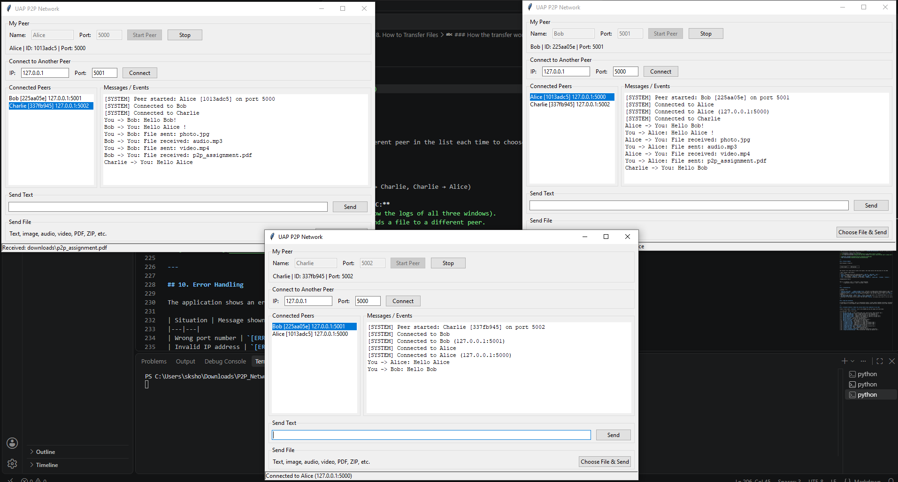
> 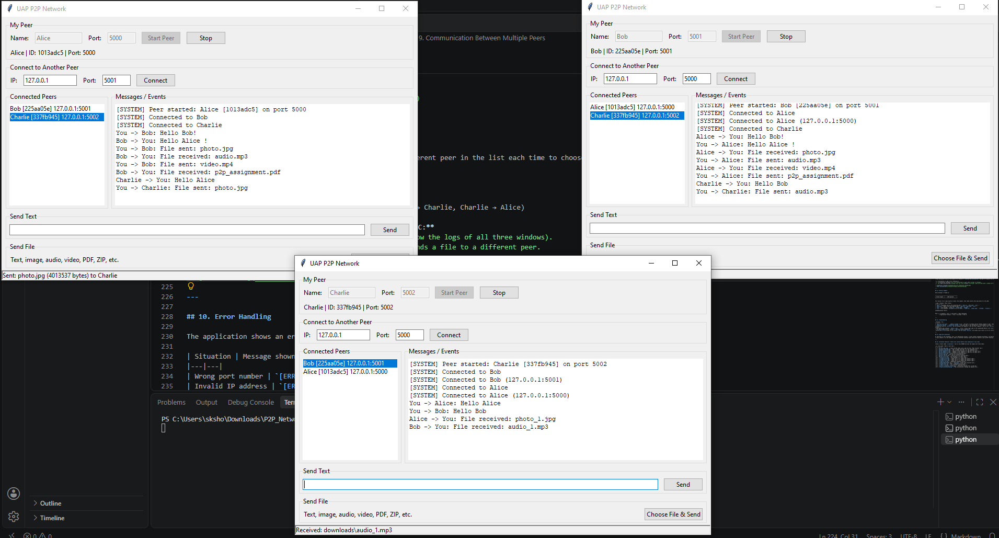

---

## 10. Error Handling

The application shows an error in the log (and status bar) instead of crashing. Examples:

| Situation | Message shown |
|---|---|
| Wrong port number | `[ERROR] Invalid port (must be 1-65535)` |
| Invalid IP address | `[ERROR] Invalid IP address: ...` |
| Peer not running / connection refused | `[ERROR] Connection failed: ... Connection refused` |
| Sending without selecting a peer | `[ERROR] Select a peer from the Connected Peers list first` |
| Sending before starting your peer | `[ERROR] Start your peer first` |
| File does not exist | `[ERROR] File does not exist: ...` |
| Invalid file size in metadata | Transfer is rejected and the connection is closed safely |
| Peer disconnects (also in the middle of a transfer) | `[SYSTEM] Bob disconnected`; the peer is removed from the list and any incomplete file is deleted |

> 1. A **connection refused** error (try connecting to a port where no peer is running).
> 2. The **peer-disconnected** message after you click **Stop** on one peer (show the other peer's window with the peer removed from the list).
>
> 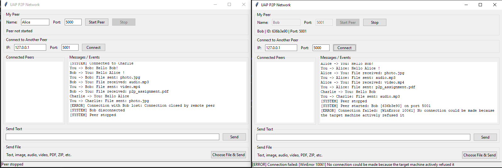
> 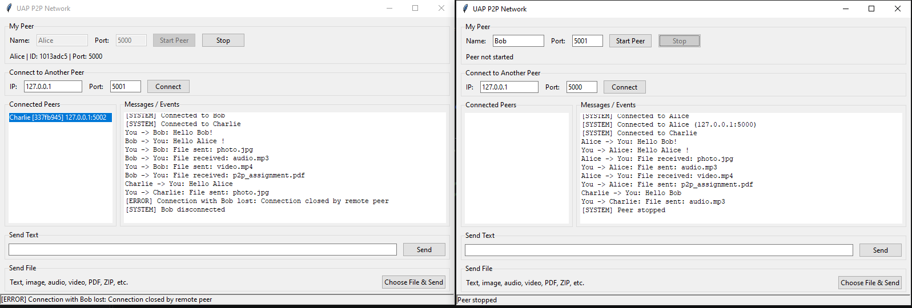

---

## 11. Protocol Summary

Every message is framed as:

```
+----------------+-----------------------+
| 4-byte length  |     JSON payload      |
+----------------+-----------------------+
```

The receiver first reads exactly 4 bytes (the length), then reads exactly that many bytes for the JSON.

| Type | Purpose | Main fields |
|---|---|---|
| `hello` | Handshake sent by the connecting peer | `peer_id`, `peer_name`, `port` |
| `hello_ack` | Reply from the accepting peer | `peer_id`, `peer_name`, `port` |
| `text` | Text message | `sender_id`, `sender_name`, `message` |
| `file` | File metadata, followed by raw file bytes | `sender_id`, `sender_name`, `filename`, `filesize` |

**Communication flow:**

```
Peer A -> IP Address + Port -> TCP Socket -> HELLO Handshake
       -> Application Protocol -> Text / File Data -> Peer B
```

---

## 12. Troubleshooting

| Problem | Fix |
|---|---|
| `Could not start peer: ... address already in use` | The port is already used by another program or peer. Choose a different port. |
| `Connection failed: ... Connection refused` | The other peer is not started yet, or the IP/port is wrong. |
| Connection works on `127.0.0.1` but not between two computers | Use the other computer's LAN IP (not `127.0.0.1`), put both on the same Wi-Fi/LAN, and allow Python through the firewall. |
| Send button does nothing / `Select a peer...` error | Click a peer name in the **Connected Peers** list first. |
| `No module named tkinter` (Linux) | `sudo apt install python3-tk` |
| Bottom part of the window is not visible | Use the latest `main.py`; the window sizes itself to fit all controls. |

---

## 13. Scope and Limitations

As specified in the assignment, this is an educational project. It does **not** implement blockchain, encryption, authentication, NAT traversal, DHT, or a central server. It works on a local network or on one computer; peers on different networks would need extra features such as NAT traversal.

---

## 14. Screenshot Checklist (remove this section before final submission if you like)

Create a folder named `screenshots/` next to this README and save the images with these names:

| # | File name | What it must show |
|---|---|---|
| 1 | `01_start_peer.png` | A peer started (name, port, peer ID line, "Peer started" log) |
| 2 | `02_peerA_connected.png` | Peer A window with Peer B in the connected list |
| 3 | `03_peerB_connected.png` | Peer B window with Peer A in the connected list |
| 4 | `04_two_computers_A.png` | Computer A with Computer B's LAN IP in its peer list |
| 5 | `05_two_computers_B.png` | Computer B with Computer A's LAN IP in its peer list |
| 6 | `06_multi_alice.png` | Alice with two connected peers |
| 7 | `07_multi_bob.png` | Bob with two connected peers |
| 8 | `08_multi_charlie.png` | Charlie with two connected peers |
| 9 | `09_text_A_to_B.png` | Text message A → B (both logs) |
| 10 | `10_text_B_to_A.png` | Text message B → A (both logs) |
| 11 | `11_image_A_to_B.png` | Image sent A → B (sender and receiver logs) |
| 12 | `12_audio_B_to_A.png` | Audio sent B → A (sender and receiver logs) |
| 13 | `13_video_A_to_B.png` | Video sent A → B (sender and receiver logs) |
| 14 | `14_pdf_or_zip.png` | *(Optional)* PDF/ZIP transfer |
| 15 | `15_downloads_folder.png` | `downloads/` folder with received files |
| 16 | `16_peerC_text.png` | Peer C sending/receiving text |
| 17 | `17_peerC_file.png` | File transfer involving Peer C |
| 18 | `18_error_connection_refused.png` | Connection refused error in the log |
| 19 | `19_peer_disconnected.png` | "Peer disconnected" message and updated list |
